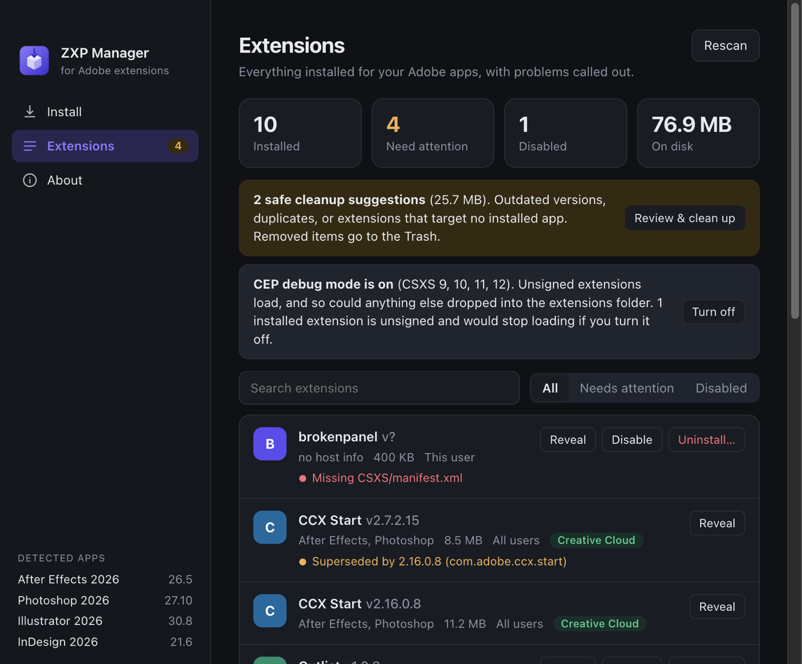
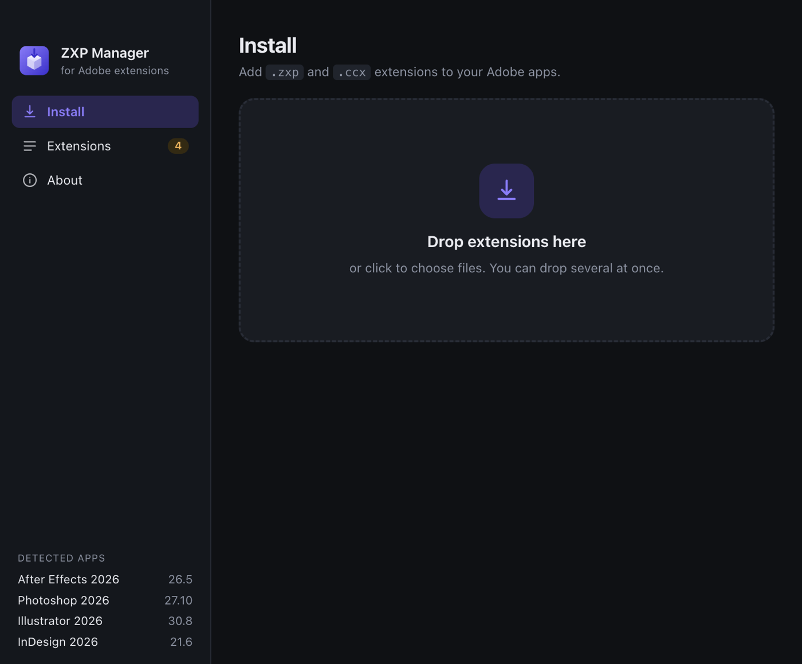
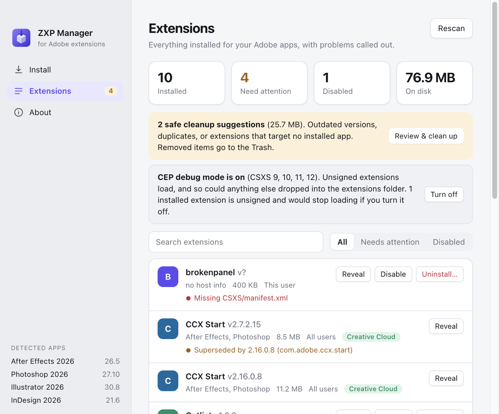

<p align="center">
  
</p>

<h1 align="center">ZXP Manager</h1>

<p align="center">
  Install, audit and cleanly remove Adobe extensions on macOS and Windows.<br>
  A modernised, <b>vibe-coded</b> fork of <a href="https://github.com/elements-storage/ZXPInstaller">ZXPInstaller</a>.
</p>

<p align="center">
  
</p>

> [!IMPORTANT]
> **This fork is vibe-coded.** It was written quickly with an AI coding assistant (Claude) and verified by running it against real Creative Cloud setups, not by a full automated test suite. Treat it as a useful tool from a hobbyist, not as audited software.
> It is designed to be cautious: nothing is hard-deleted (removals go to the Trash) and every destructive action asks first. Even so, keep backups of anything you can't replace.

## Why this fork exists

The original ZXPInstaller was a great idea, but its last release was in 2021 and it has not kept up with Creative Cloud. On a current machine it runs into problems:

| Upstream (v1.8.2) | This fork |
| --- | --- |
| Electron 15 | Electron 44, electron-builder 26 |
| Bundles Adobe's `ExManCmd`, an **Intel-only** binary from 2021 (breaks when Rosetta goes away) | Uses the **Unified Plugin Installer Agent** that ships with Creative Cloud (native, handles `.zxp` **and** `.ccx`); the bundled `ExManCmd` is only a fallback |
| Depends on the abandoned `esm` package, which crashes on modern Node | Removed |
| Dropping files relies on `File.path`, which Electron removed in v32 | Uses `webUtils.getPathForFile` |
| Reports raw `status = -410` style errors | Friendly messages, plus it opens the archive to explain *why* (for example "this is a wrapper around other installers") |
| Install only | Install **and** manage |

## Features

- **Install:** drop one or many `.zxp` / `.ccx` files anywhere in the window, on the Dock icon, or open them with the app. They install in sequence with a result per file.
- **Extensions overview:** scans user and system CEP folders and the Adobe apps you actually have installed, with sizes, target apps and versions.
- **Problem detection:**
  - older versions and duplicates of the same extension
  - extensions that target no installed Adobe app, or whose declared host version range excludes yours
  - extensions that need a newer CEP runtime than Creative Cloud ships (CEP 12)
  - broken manifests and unsigned extensions
  - whether CEP debug mode is on (with a button to toggle it)
- **Safe cleanup:** one-click review of suggested removals. Everything goes to the Trash.
- **Disable / enable:** moves an extension to a sibling `extensions.disabled` folder. Fully reversible.
- **Deep uninstall:** lists every copy of an extension plus its CEP panel caches, logs, preferences and app data, matched strictly by bundle and panel id. You tick what goes.
- **Clears Adobe's installer registry** on uninstall. Adobe's installer keeps its own database, and if you only delete the files it refuses to reinstall with "newer version already installed" (error 418). ZXP Manager removes the stale registration too, and lists registrations that have no folder (including UXP plugins).
- Adobe-managed extensions (Creative Cloud panels) are shown but protected from changes.
- Light and dark mode.

<p align="center">
  
  
</p>

*Screenshots use built-in demo data (`ZXP_DEMO=1`), not a real machine.*

## Status and limits

- Developed and tested on **macOS (Apple Silicon)** with Creative Cloud 2026 apps. The Windows code paths exist but are **untested**.
- No packaged releases yet. Build it yourself (below). Builds are unsigned and un-notarised, so macOS will warn on first launch.
- UXP plugins are listed and removable via Adobe's installer, but not analysed like CEP extensions.
- Unsigned extensions only load while CEP debug mode is on. ZXP Manager shows the state and lets you change it; it never changes it silently.
- Several actions need an administrator password on macOS (anything under `/Library`). The app asks via the standard system prompt.
- Use it only for software you are entitled to use.

## Run it

Requires [Node.js](https://nodejs.org) 20+ and Yarn 1.

```bash
git clone https://github.com/taehas/ZXPInstaller.git
cd ZXPInstaller
yarn
yarn dev
```

Try the UI without touching your real extensions:

```bash
ZXP_DEMO=1 yarn dev
```

## Build

```bash
yarn pack:mac-arm64   # or pack:mac-x64
yarn pack:win         # run on Windows
```

Artifacts land in `dist/`.

## How it works

An Electron app. The renderer scans the CEP extension folders (`~/Library/Application Support/Adobe/CEP/extensions` and `/Library/Application Support/Adobe/CEP/extensions` on macOS, the `%APPDATA%` and `Program Files (x86)\Common Files` equivalents on Windows), parses each `CSXS/manifest.xml`, and compares it with the Adobe apps found on disk. Installs and registry changes go through Adobe's `UnifiedPluginInstallerAgent`. See [`app/src`](app/src): `scanner.js` (discovery and analysis), `leftovers.js` (deep uninstall matching), `actions.js` (reversible operations), `installer.js` and `upia.js` (Adobe's installer).

## Contributing

Issues and PRs are welcome, especially Windows testing. Because the code is AI-assisted, please describe what you actually ran when you open a PR.

## Credits and license

ZXP Manager is a fork of [ZXPInstaller](https://github.com/elements-storage/ZXPInstaller), originally created by [@maxoos](https://github.com/maxoos) and maintained by [Cameron McEfee](https://github.com/cameronmcefee), [GuideGuide](https://github.com/guideguide) and [ELEMENTS Media Storage](https://elements.tv). All credit for the original idea and implementation goes to them. This fork is not affiliated with or endorsed by them.

Adobe, Creative Cloud, After Effects, Photoshop, Illustrator, InDesign and Premiere Pro are trademarks of Adobe. This project is not affiliated with Adobe.

Licensed under the [GPL-2.0](LICENSE), same as the original.
